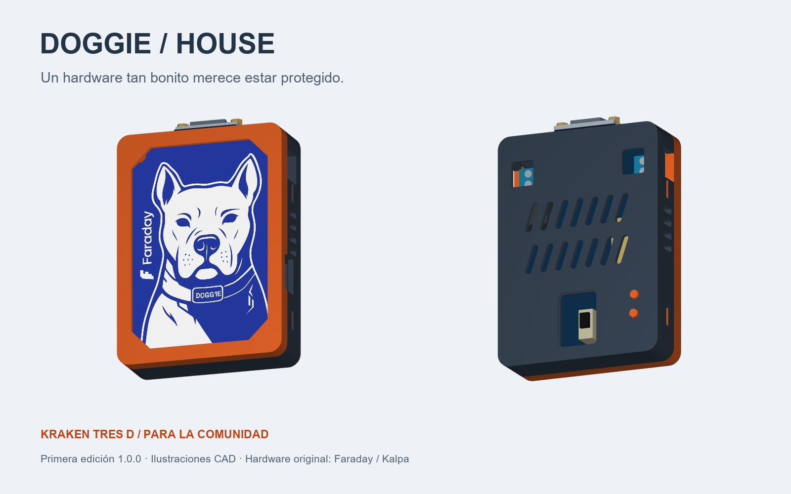
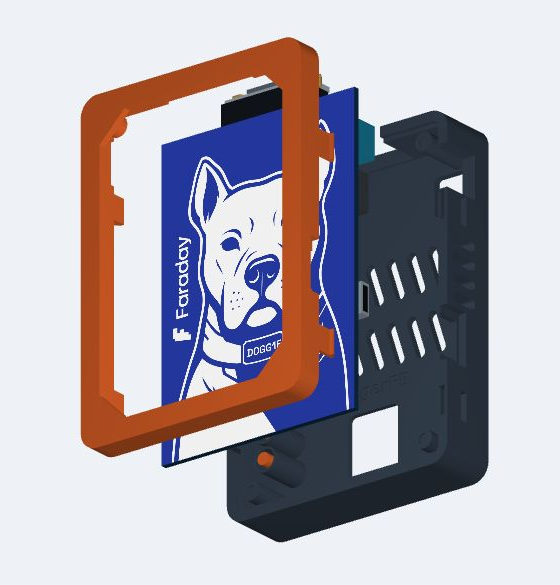

# Doggie House

**Un hardware tan bonito merece estar protegido.**

Una carcasa impresa en 3D para EvilDoggie: el perro a la vista, los controles al alcance y una casa para acompañarlo al taller, a una conferencia o al siguiente proyecto.

[Visor 3D y montaje](https://rogerf5-security.github.io/Case-Evil_Doggie/) · [Descargar STL](models/stl/) · [Guía de ensamblaje](docs/ASSEMBLY_ES.md) · [Guía PDF](docs/GUIA_MONTAJE_ES.pdf) · [English](docs/README_EN.md)

## De la EKOparty al taller

En la **EKOparty 2026, en Argentina**, los amigos de **Faraday** nos regalaron un EvilDoggie. Al regresar a Guatemala, una idea se vino con nosotros: un hardware tan bonito debía tener una casa para cuidarlo.

Lo trabajamos en el taller de **Kraken Tres D**, donde modelamos esta carcasa para proteger la placa sin esconder su diseño ni perder acceso a sus conexiones. Hoy compartimos los archivos con la comunidad para que cualquiera pueda imprimirla, ensamblarla y aportar mejoras.

Gracias a los amigos de Faraday por el regalo que dio origen al proyecto, y a quienes comparten conocimiento, hardware y horas de taller. Esta casita también es para ustedes.

## La carcasa

- Marco abierto para mantener visibles la ilustración del perro y sus LED.
- Tapa con **cuatro pestañas liberables**, sin tornillos, tuercas ni insertos.
- Acceso a USB-C, DB9, borneras, palanca GOOD / EVIL y botones BOOT / RESET.
- Dos opciones de tapa: pulsadores impresos cautivos o acceso directo a los botones originales.
- Placa centrada sobre sus cuatro agujeros originales, sin perforaciones adicionales.
- 14 ranuras posteriores y 8 laterales; ventana transparente de 1 mm opcional.

## Qué imprimir

Descargar los archivos de [models/stl](models/stl/) e importar en milímetros a **escala 100 %**. Elegir **una** configuración:

| Configuración | Piezas |
|---|---|
| Con pulsadores cautivos | [Marco frontal](models/stl/01_front_frame.stl) + [tapa](models/stl/02_rear_cover.stl) + [dos pulsadores](models/stl/03_two_captive_buttons.stl) |
| Con acceso directo a botones | [Marco frontal](models/stl/01_front_frame.stl) + [tapa alternativa](models/stl/04_rear_direct_access_optional.stl) |
| Prueba del cierre antes de imprimir | [Muestra frontal](models/stl/08_snap_test_front.stl) + [muestra trasera](models/stl/09_snap_test_rear.stl) |
| Prueba de abertura USB | [Muestra frontal USB](models/stl/10_usb_test_front.stl) + [muestra trasera USB](models/stl/11_usb_test_rear.stl) |

También se incluyen las disposiciones [3MF estándar](models/doggie-house-standard.3mf) y [3MF de acceso directo](models/doggie-house-direct-access.3mf), con las piezas orientadas. Contienen geometría; seleccionar el perfil de la impresora y del filamento en el laminador.

**Punto de partida de impresión:** PETG sin fibras, boquilla de 0,4 mm, capa de 0,20 mm, 4 paredes y 20 % de relleno. Marco y tapa con la cara exterior sobre la cama; pulsadores de pie con brim. Probar primero las muestras del cierre con el mismo PETG del conjunto.

## Cómo ensamblarla

1. **Preparar.** Desconectar el EvilDoggie y retirar rebabas y soportes que obstruyan puertos, pestañas o guías.
2. **Ventana opcional.** Cortar una lámina transparente de 1 mm con la [plantilla 1:1](docs/window-template-1to1.svg) y fijarla al reborde con cinta fina, sin invadir apoyos ni componentes.
3. **Asentar la placa.** Colocar el marco sobre una superficie blanda, cara exterior hacia abajo. Orientar el perro hacia la ventana y el DB9 hacia el extremo superior. Bajar la PCB sobre los cuatro pines, sin forzarla.
4. **Colocar pulsadores.** Para la tapa estándar, introducirlos desde dentro, extremo estrecho hacia fuera y pestaña de retención hacia dentro. Comprobar su movimiento libre. Con la tapa alternativa se omite este paso.
5. **Cerrar.** Alinear puertos y junta; presionar gradualmente junto a los bordes hasta encajar los cuatro ganchos. Comprobar que la placa no se curva y ningún botón queda pulsado.
6. **Comprobar.** Verificar el recorrido de GOOD / EVIL, el retorno de BOOT / RESET y que los conectores entren completamente sin empujar la placa.

**Para abrir:** desconectar cables, presionar hacia dentro los dos ganchos de un lateral a través de sus ventanas, separar ligeramente ese borde y liberar el otro lado. Levantar la tapa recta. Practicar con las muestras del cierre facilita el primer montaje.

La [guía ilustrada](docs/ASSEMBLY_ES.md), el [PDF](docs/GUIA_MONTAJE_ES.pdf) y el [visor 3D](https://rogerf5-security.github.io/Case-Evil_Doggie/viewer/) acompañan cada paso.

## Medidas y compatibilidad

| Elemento | Medida nominal |
|---|---|
| Carcasa cerrada, sin salientes de botones | 80 × 110 × 27,8 mm |
| PCB de referencia | 70 × 100 × 2 mm |
| Agujeros de PCB | Ø 3 mm; centros a 3,7 mm de ambos bordes |
| Altura máxima de componentes de referencia | 15 mm, más 2 mm de holgura |
| Abertura de palanca | 18 × 25 mm |
| Abertura DB9 | 31,2 × 16,2 mm |

Esta es la **primera publicación comunitaria (1.0.0)**. Se comparten los STL y 3MF existentes sin modificar su geometría. Su identificador interno de CAD es `2.0.0-rc1`, heredado del desarrollo en el taller; no es el número de edición de esta publicación.

El prototipo previo permitió revisar el diseño. La geometría compartida tiene comprobaciones digitales documentadas; el ajuste del USB, el cierre PETG y los controles requieren verificación en la impresión y placa reales. Los renders muestran el modelo compartido; las [fotos del prototipo](docs/PROTOTYPE_FEEDBACK.md) muestran una etapa anterior. No hay ensayos de impacto, temperatura o fatiga. Usar las dos mitades del mismo juego.

## Explorar y colaborar

El visor HTML permite girar, acercar y ver el frente, controles, interior y despiece. También funciona sin conexión: descargar el repositorio y abrir [viewer/index.html](viewer/index.html) en un navegador con WebGL.

¿Imprimiste una casita? Compartí fotos, revisión de placa, material y ajuste. Los reportes con medidas y los pull requests ayudan a que más EvilDoggies encuentren casa. Ver [cómo contribuir](CONTRIBUTING.md), [notas técnicas](docs/DESIGN_NOTES.md) y [comprobaciones de montaje](docs/RELEASE_CHECKLIST.md).

## Créditos y licencia

- Modelado y trabajo de taller: **Kranken Tres D** y colaboradores de Doggie House.
- Hardware, firmware e ilustración original: [Faraday / Kalpa](https://github.com/infobyte/doggie).
- Carcasa y documentación: [licencia MIT](LICENSE). Atribuciones de terceros en [THIRD_PARTY_NOTICES.md](THIRD_PARTY_NOTICES.md).

Un proyecto comunitario independiente para cuidar y disfrutar el hardware original.
