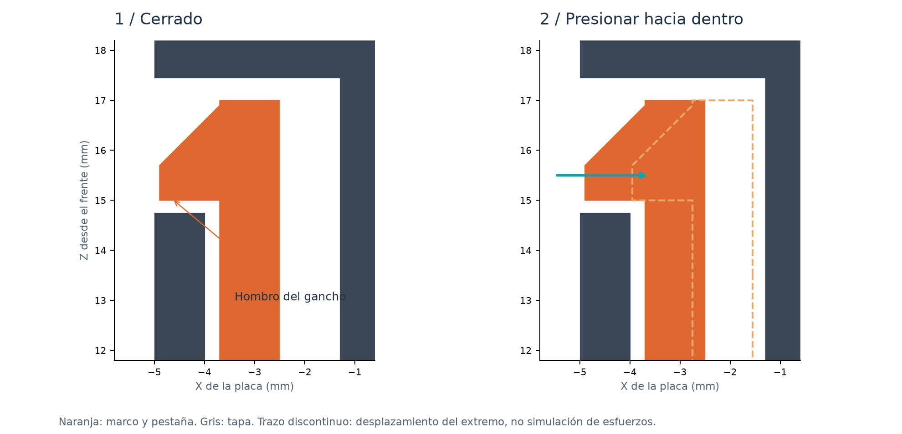

# Assembly and maintenance

[Project](README_EN.md) · [Detailed illustrated Spanish guide](ASSEMBLY_ES.md)

## Parts and printing

Print `01_front_frame`, `02_rear_cover` and the two buttons in `03`.
Alternatively use cover `04` without printed buttons. No metal fasteners are needed.
Optional window: cut 1 mm transparent PET/polycarbonate using the 1:1 SVG template;
verify its 50 mm scale bar and fix it to the inside ledge with small pieces of thin tape.

Use unfilled PETG for the flexible frame. Start with 0.4 mm nozzle, 0.20 mm
layers, 4 walls and 20% infill, using your actual filament profile. The exterior
faces of frame and cover sit on the bed; the frame latches stand upward.
Print buttons upright on their 4 mm tips with a brim. Inspect small bridges
and remove any support/reburrs that could block the latches or buttons.
These are design starting settings, not a physically validated v2 slicing preset.

## First fit checks

Print latch coupons `08` + `09` using the final PETG. Confirm that the hook locks
and releases by pressing inward, without whitening or cracking the root.
USB coupons `10` + `11` reproduce the actual opening; align their joint with
the board's component-side surface. They test local clearance, not the absolute
position along the whole board. Do not hang or lever them from the connector.
Print `12` to check RogerF5 engraving. Templates `05` / `06` check PCB and controls.
Coupon `07` holes, left to right: 2.5 / 2.7 / 3.0 / 4.6 / 6.4 mm.

## Assembly

1. Disconnect all cables. Place the frame exterior face down on a soft surface.
2. Fit the optional transparent sheet; keep the four PCB supports and latches clear.
3. Place the board dog-side toward the window, DB9 toward the top. Seat its four
   original Ø 3 mm holes over the Ø 2.5 mm locating pins. All corners must rest flat.
4. For cover `02`, insert the two button rods from inside, narrow tips outward.
   Their retaining flanges stay inside. Verify free movement before closing.
5. Align connectors, tongue and four latch channels. Press gradually near the
   edges until all four hooks engage. Do not hammer or press on board components.
6. Check the seam, all connectors, full GOOD/EVIL travel, and BOOT/RESET return.
   Nominal button clearance is 0.35 mm; adjust rod length for a different switch height.

## Opening

Disconnect cables. Press the two hooks on one side inward through their release
windows, using a fingernail or a plastic tip. Lift that edge just enough to keep
it disengaged, then release the other side. Lift the cover straight off; never
use USB or DB9 as a lever. Practice with the latch coupons first.

Confirm that USB seats fully without moving the PCB, the cable moulding clears
the opening, the four hooks retain/release, no button stays pressed, and the
optional sheet touches no LEDs. Record results in [the release checklist](RELEASE_CHECKLIST.md).
Do not label this revision physically validated until the new USB relief and
PETG latches have been tried on the real board.
