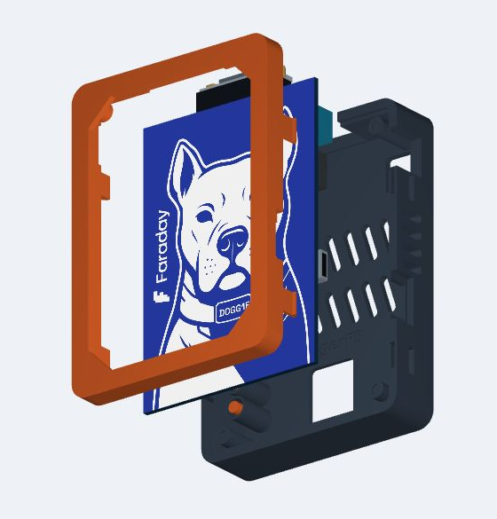
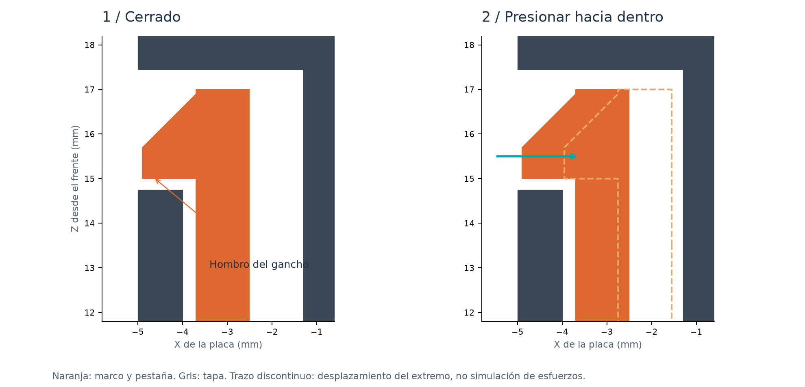

# Montaje de Doggie House

[Volver al proyecto](../README.md) · [PDF ilustrado](GUIA_MONTAJE_ES.pdf) · [English](ASSEMBLY_EN.md)

Primera edición comunitaria. Unidades: milímetros. Cierre liberable sin tornillos.

## 1. Preparar las piezas

| Cantidad | Pieza | Archivo / especificación |
|---|---|---|
| 1 | Marco frontal con cuatro pestañas | `01_front_frame.stl` |
| 1 | Tapa de componentes | `02_rear_cover.stl` |
| 2 | Pulsadores cautivos | Ambos en `03_two_captive_buttons.stl` |
| 1 | Placa original | EvilDoggie / Doggie, 70 × 100 × 2 mm |
| Opcional | Ventana | PET o policarbonato transparente, 1 mm; plantilla SVG 1:1 |
| Opcional | Fijación de ventana | Puntos pequeños de cinta fina en el reborde |

**No se usan tornillos, tuercas, insertos ni pegamento para cerrar la carcasa.**
La alternativa `04_rear_direct_access_optional.stl` sustituye a `02` y elimina
los dos pulsadores impresos: sus botones originales se alcanzan por una ventana
de servicio. No imprimir las dos tapas para un mismo conjunto.

## 2. Imprimir con la orientación incluida

- Material de diseño: PETG sin fibras, especialmente para el marco con pestañas.
- Punto de partida: boquilla 0,4 mm, capa 0,20 mm, 4 paredes, relleno 20 %.
- El **marco** se imprime sobre su cara exterior plana. Las cuatro pestañas suben
  hacia arriba; no tumbar el marco sobre una pestaña.
- La **tapa** se imprime con la cara exterior sobre la cama y el interior hacia arriba.
  El interior queda hacia arriba. Revisar los detalles en el laminador.
- Los **pulsadores** se imprimen de pie sobre su extremo de 4 mm, con un pequeño brim.
- Las piezas se orientan como muestran los STL y los 3MF. No usar soportes que
  se fusionen con las pestañas, sus canales o las guías de botones.
- Revisar en el laminador los pequeños puentes de puertos, enganches y el grabado.
  Si el perfil necesita soporte, limitarlo a lo necesario y retirarlo antes de montar.
- No activar planchado o procesos que rellenen el grabado. No reducir globalmente
  la escala para compensar un cierre duro: ajustar la holgura del parámetro.

Estos son valores de partida; ajustar el perfil a la impresora y al filamento.

## 3. Probar los cambios con poca pieza

1. Imprimir `08` y `09` en el PETG definitivo. Son un tramo real del cierre.
   Acoplarlos con las caras planas exteriores hacia fuera. La pestaña naranja debe
   entrar por la junta y su gancho aparecer en la ventana lateral de la otra pieza.
2. Comprobar que se mantiene cerrado sin fuerza externa, que se abre presionando
   la pestaña hacia dentro y que la raíz no se agrieta ni blanquea.
3. `10` y `11` reproducen el sector USB. Alinear sus caras de junta a la altura de
   la cara de componentes de la PCB, con los extremos recortados coincidentes.
   Es una muestra de la abertura, no un soporte que deba colgarse del conector.
   Presentar el cable sin hacer palanca. La carcasa completa confirma su posición
   absoluta; el cupón por sí solo no registra el largo de toda la placa.
4. Las plantillas `05` y `06` permiten comprobar placa y controles si se usa otra revisión.
   El cupón `07` ofrece orificios Ø 2,5 / 2,7 / 3,0 / 4,6 / 6,4 mm, de izquierda a derecha.

## 4. Colocar la ventana opcional

Cortar una lámina transparente de 1 mm usando `window-template-1to1.svg`.
Imprimir la plantilla al 100 % y comprobar que su regla mide 50 mm.
Fijarla al reborde interior del marco con pequeños puntos de cinta, sin invadir
las cuatro bases de apoyo, los pines ni las pestañas. La lámina debe quedar
separada de la placa. También se puede montar el frente abierto.

## 5. Asentar la placa

Con USB y DB9 desconectados, apoyar el marco con la cara exterior sobre una
superficie blanda. Orientar el perro hacia la ventana y DB9 hacia el extremo
superior del marco. Bajar la placa sobre los cuatro pines de Ø 2,5 mm.
Los agujeros de Ø 3 mm permiten centrarla sin perforar ni apretar el PCB.
Las cuatro esquinas deben apoyar; no compensar una esquina levantada presionando
los componentes o el puerto.

## 6. Preparar los botones

Si se eligió tapa `02`, introducir cada pulsador desde dentro: extremo estrecho
hacia fuera, pestaña de retención hacia dentro. Comprobar su movimiento libre.
BOOT corresponde al agujero superior y RESET al inferior, junto a la palanca.
La altura de referencia del botón es 1,5 mm;
la varilla deja una holgura nominal de 0,35 mm, que debe comprobarse en la placa real.
Si al cerrar se pulsa un botón continuamente, abrir y corregir la longitud.

## 7. Cerrar sin tornillos

Alinear primero DB9, USB-C y borneras. Presentar la tapa paralela al marco para
que la lengua perimetral entre en su alojamiento y las cuatro pestañas entren
en sus canales. Presionar junto a los bordes, de manera gradual, hasta que los
cuatro ganchos entren en las ventanas laterales. No presionar el centro de la
tapa ni golpearla. Comprobar la junta en todo el contorno.

Si una pestaña no entra con presión moderada de los dedos, no forzarla:
abrir, revisar rebabas, orientación y muestra de cierre. El cierre no se debe
calentar, pegar ni doblar permanentemente para conseguir el ajuste.

## 8. Abrir para mantenimiento

Desconectar los cables. A través de las dos ventanas de un mismo lado, presionar
los ganchos **hacia el interior** con la uña o una punta plástica y separar ese
borde apenas lo suficiente para que no se vuelva a enganchar. Liberar después
el otro lado. Levantar la tapa recta, sin usar el conector USB o DB9 como palanca.
La muestra `08` + `09` permite practicar el gesto antes del montaje completo.

## 9. Comprobar el conjunto

- Los cuatro enganches retienen la tapa y se liberan sin daños.
- Ningún botón queda pulsado en reposo; BOOT y RESET actúan y regresan.
- La palanca completa ambos extremos GOOD / EVIL sin rozar el marco del hueco.
- El USB entra hasta el final sin empujar la placa; el plástico del cable no toca el borde.
- DB9 se conecta y sus fijaciones siguen accesibles; se alcanzan las borneras.
- La placa no se curva; la lámina opcional no toca LEDs ni componentes.
- Las 14 ranuras traseras y las 8 laterales están despejadas.

Registrar el resultado en [RELEASE_CHECKLIST.md](RELEASE_CHECKLIST.md).
El ajuste del USB y el cierre necesitan comprobarse en la placa y la impresión reales.
Los archivos conservan su revisión interna de taller; esta guía acompaña la primera publicación comunitaria.
