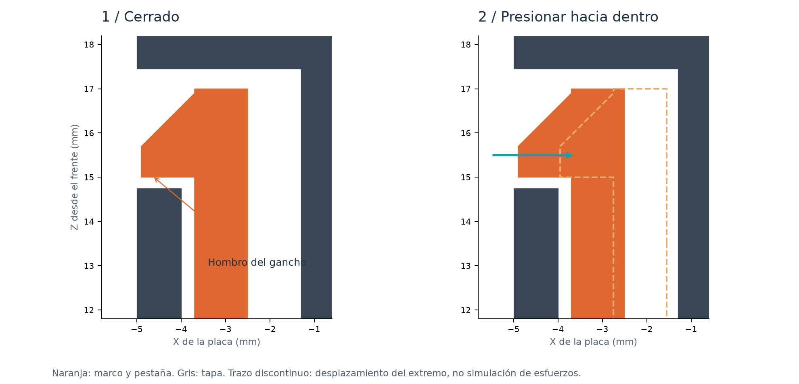
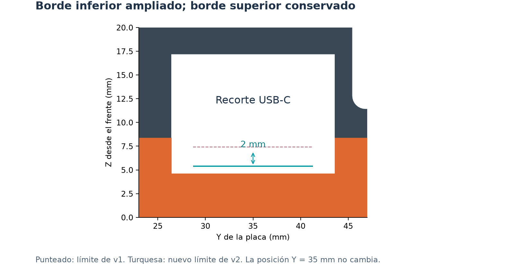

# Design notes / notas de diseño

## Coordinate system

All measurements use millimetres. XY follows the component side: lower-left PCB
corner is (0,0); X points right; Y points toward DB9. Z points from the dog-side
exterior of the frame toward the component cover. Do not measure assembly Z from
the reoriented STL print poses.

| Datum | Z, mm |
|---|---|
| Exterior front face | 0 |
| Inside front ledge | 2.4 |
| PCB dog-side surface | 6.4 |
| PCB component surface / main joint | 8.4 |
| Inner component roof | 25.4 |
| Exterior component cover | 27.8 |

The frame extends to Z = 17 at its flexible latches; its rigid main wall ends
at the joint. Therefore adding the two STL bounding-box heights does not yield
the assembled case thickness.

## PCB support and closure

Reference board measurements: 70 × 100 × 2 PCB, four Ø 3 holes with 2.2 mm edge-to-edge gap,
so hole centres are (3.7,3.7), (66.3,3.7), (3.7,96.3), (66.3,96.3).
Ø 2.5 pins locate the board. Upper corner pads leave 0.1 mm nominal axial space,
with relief for the pin ends. Closure load goes through the perimeter joint,
not through a long bolt clamping the board. No metal fasteners are used in v2.

Four PETG cantilevers are placed at Y = 14 and 75 on both long sides. Nominal
beam thickness is 1.2 mm, width 8 mm, total free length 14.6 mm before the small
root gusset. The ramp and catch shoulder are separate features of the same
connected frame. Channels provide room for the upper tip to move inward by
0.95 mm; the retaining shoulders engage after the joint moves apart by 0.25 mm.

CAD checks prove clearance and engagement, not spring force, layer adhesion,
impact survival or number of opening cycles. Print the two latch coupons in the
actual PETG first. Avoid scaling the whole model to tune a latch. The current
bay dimensions are defined in `latch_bay`; hook geometry is in `latch`.

## USB correction

The reference measurement was the 10 mm port width, with its lower edge
at Y = 30, giving nominal centre Y = 35. Feedback on the printed prototype asked
to lower the case opening through its thickness. The exact physical offset was not measured.

The v2 starting correction is **2 mm extra opening at the lower edge**, from
Z = 7.4 to 5.4, preserving the upper edge at Z = 16.0. Inner width is 12.6.
The outer cable relief is 17.2 wide × 12.6 high, beginning at Z = 4.6.
This does not move the physical connector or change its PCB-axis Y coordinate.

`usb_z_adjustment = -2` and `usb_y_adjustment = 0` are separate parameters.
`usb_cut_height` was increased to retain the previous upper edge; if the lower
offset changes, review the upper edge explicitly. Model clearances use the
nominal connector and a lower relief block; real cable mouldings are not standard.

## Ventilation

| Opening | v1 | v2 |
|---|---|---|
| Rear dedicated vents | 5 | 14 |
| Rear open area | 243.99 mm² | 599.53 mm² |
| Dedicated through side vents | 0 | 8 |
| Side open area | 0 | 242.22 mm² |

Terminal and control openings are excluded from these totals. The old side
grooves were grip recesses. The 2.457 ratio compares rear geometric open area
only; it is not a measured change in airflow or operating temperature.

## Signature and controls

All exterior text was removed. The existing workshop mark is engraved from the interior roof,
0.5 mm deep. It is mirrored in component-side XY so it reads normally when
viewed into the open cover. Bold glyphs are normalized to 5.2 mm height and
expanded by 0.12 mm, giving approximately 5.44 mm actual height. Roof remaining
under the engraving is 1.9 mm. A roof patch is exported as a print coupon.

BOOT (63.6,22.6), RESET (63.3,13.6), toggle centre (35,14) and terminal positions
were estimated from the original board photos; they are preserved from v1.
The 18 × 25 toggle opening was used for the prototype. The printed prototype
shows accessible controls, but button rod preload must still be checked.

## Validation boundaries

`cad/build.py` checks closed meshes, connected printable pieces, positive volume,
print poses, STL/3MF reimport, assembly interference, nominal connector keepouts,
free latch tip travel, and retaining shoulder engagement. It writes a source
digest to `docs/validation.json`. These are mechanical geometry checks.

The following require a new physical print: snap retention/release force,
fatigue and layer adhesion, actual USB cable fit, signature legibility,
button actuation, and temperature. v1 photos in `docs/photos` document the
feedback that led to v2; they are not evidence that v2 has been printed.
