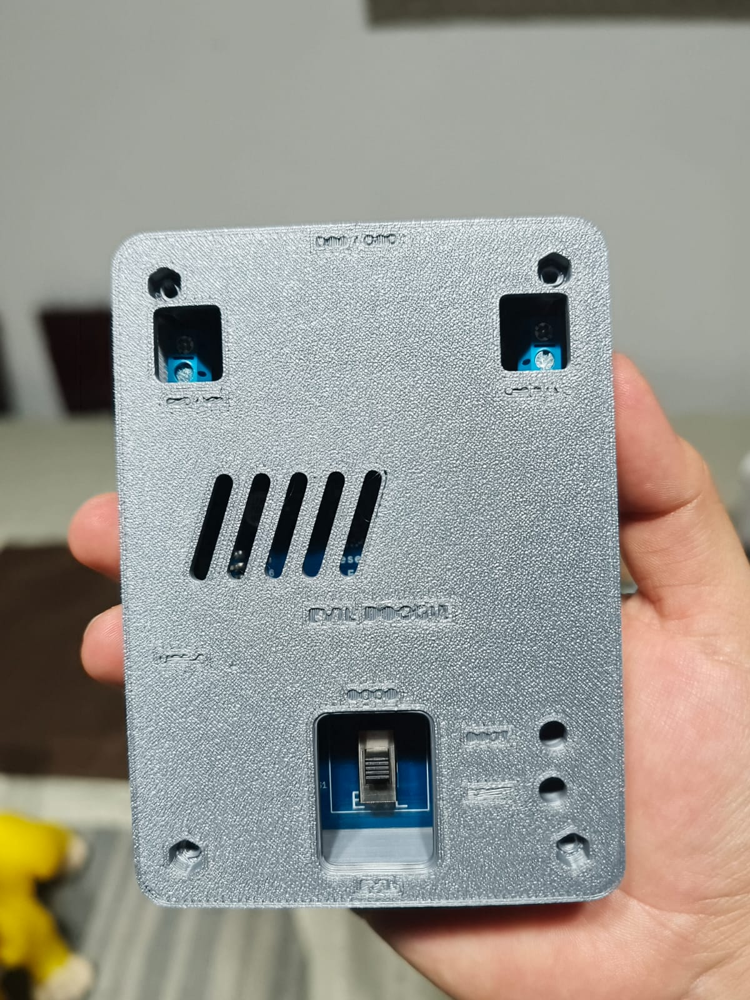
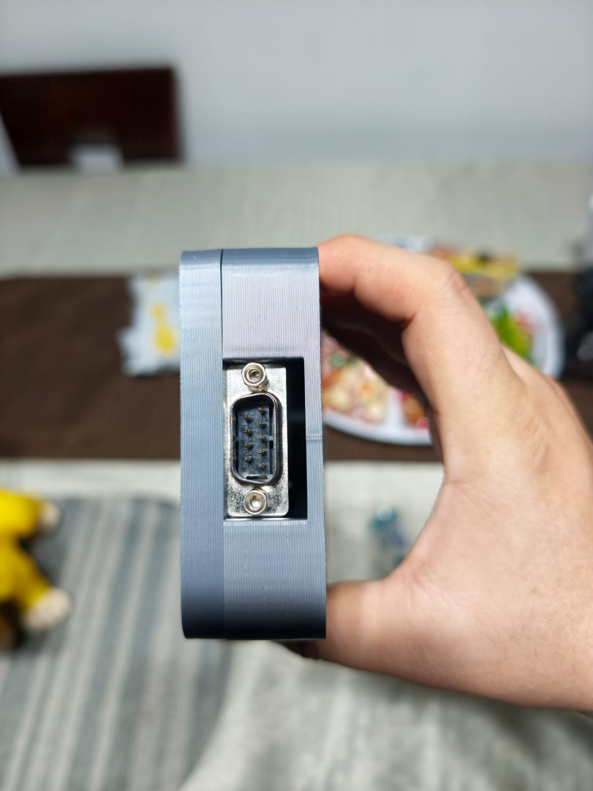
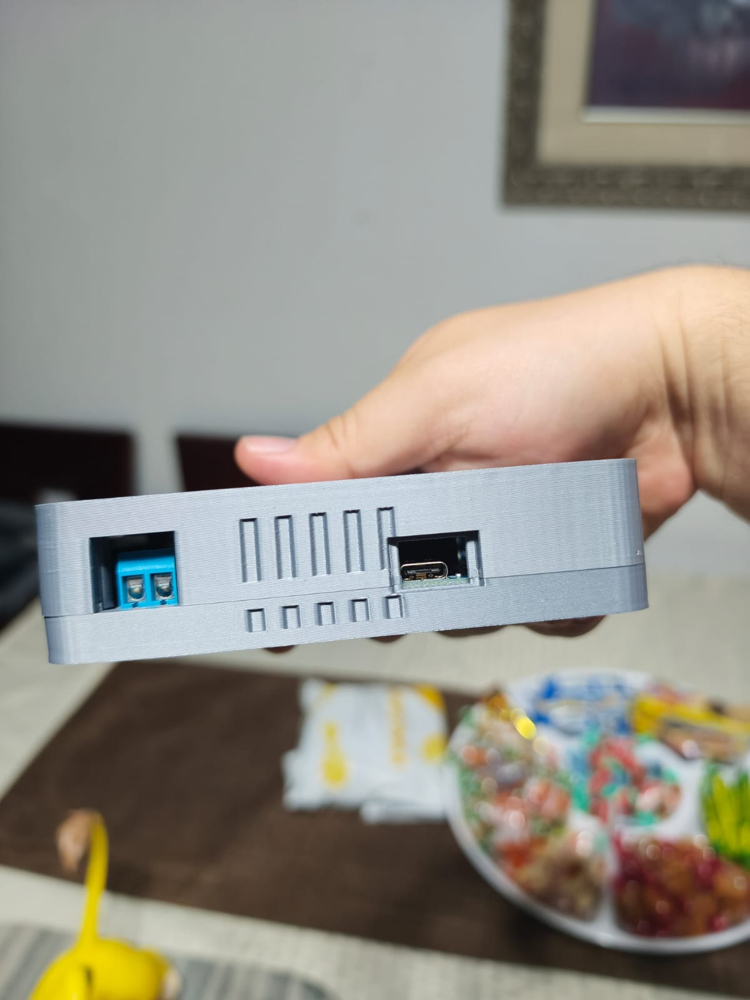

# Del prototipo a la revisión 2

Estas fotografías son de **v1 impresa por RogerF5**. Los renders y el visor
muestran **v2 CAD**, cuya impresión aún debe comprobarse.

| Observación del prototipo | Cambio en v2 |
|---|---|
| Letras exteriores poco legibles | Se retiran todas; solo queda RogerF5 grande por dentro |
| USB demasiado justo por su borde inferior | Recorte más ancho y 2 mm de rebaje adicional propuesto |
| Tornillos largos difíciles de conseguir | Eliminados: cierre con cuatro pestañas liberables |
| Ventilación insuficiente | Rejilla posterior de 14 ranuras + 8 laterales pasantes |
| DB9 visible y accesible | Se conserva su abertura nominal y su acceso |

La v1 tenía cinco rebajes de agarre en cada lateral; no eran pasos de aire.
El área abierta posterior de v2 se calcula directamente a partir del CAD.
El resultado térmico y la fuerza de las pestañas requieren pruebas reales.
