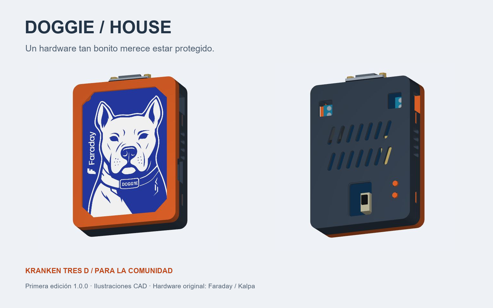

# Doggie House

**Hardware this beautiful deserves a home.**

[Español](../README.md) · [3D viewer and assembly](https://rogerf5-security.github.io/Case-Evil_Doggie/) · [STL files](../models/stl/) · [Assembly guide](ASSEMBLY_EN.md)

At **EKOparty 2026 in Argentina**, our friends at **Faraday** gave us an EvilDoggie. Back in Guatemala, we took it to the **Kranken Tres D** workshop and designed a case to protect the board while keeping its artwork, LEDs, connectors and controls accessible.

This first community publication shares the printable files so anyone can build a little house for their EvilDoggie and help improve it. Thank you to Faraday for the gift that started this project, and to the community that keeps sharing tools and ideas.

## Print a case

| Configuration | Files |
|---|---|
| Captive printed buttons | STL `01` + `02` + `03`, or [standard 3MF](../models/doggie-house-standard.3mf) |
| Direct access to original buttons | STL `01` + `04`, or [direct-access 3MF](../models/doggie-house-direct-access.3mf) |
| Check the snap fit first | STL `08` + `09` |
| Check the USB opening | STL `10` + `11` |

Find all [STL files here](../models/stl/). Import at **100% in millimetres**. The 3MF files contain oriented geometry; choose your own printer and filament profile.

Start with unfilled PETG, a 0.4 mm nozzle, 0.20 mm layers, 4 walls and 20% infill. Place frame and cover exterior faces on the bed; print button rods upright with a brim. Test the latch coupons with the final material before printing the entire case.

## Put it together

1. Disconnect the board. Remove burrs and supports from latch channels and ports.
2. Optionally fit a 1 mm clear sheet using the [1:1 window template](window-template-1to1.svg).
3. Place the board dog-side toward the front window, DB9 toward the top, resting on all four locating pins.
4. For the standard cover, insert the two button rods from inside, narrow ends outward. Check free movement.
5. Align ports and the perimeter joint. Press near the edges until all four hooks engage.
6. Check USB/DB9 access, full GOOD / EVIL travel and BOOT / RESET return.

To open, disconnect cables and press one side's two hooks inward through their release windows. Lift that edge slightly, release the other side, then lift the cover straight off. See the [detailed assembly guide](ASSEMBLY_EN.md).

## Size and fit

Case: **80 × 110 × 27.8 mm**, excluding button protrusions. Reference PCB: **70 × 100 × 2 mm**. Four snap latches hold the cover without metal fasteners. An open front preserves the dog artwork; a clear sheet is optional.

This is community publication **1.0.0**, sharing the existing STL/3MF geometry unchanged. The CAD's internal workshop revision remains `2.0.0-rc1`. Digital checks are recorded in [validation.json](validation.json); physical USB fit, PETG latch behaviour and button operation need checking on the actual print. [Prototype photos](PROTOTYPE_FEEDBACK.md) show an earlier build. No impact, thermal or fatigue tests are claimed.

The self-contained [HTML viewer](../viewer/index.html) also works offline in a WebGL browser. Case geometry is the printable CAD; the PCB and components are visual references.

## Community and credits

Share print photos, board revision, material and measured fit through issues or pull requests. See [contributing](../CONTRIBUTING.md) and [technical notes](DESIGN_NOTES.md).

Case modelling: **Kranken Tres D** and Doggie House contributors. Original hardware and art: [Faraday / Kalpa](https://github.com/infobyte/doggie). Case and documentation: [MIT](../LICENSE); [third-party notices](../THIRD_PARTY_NOTICES.md).
